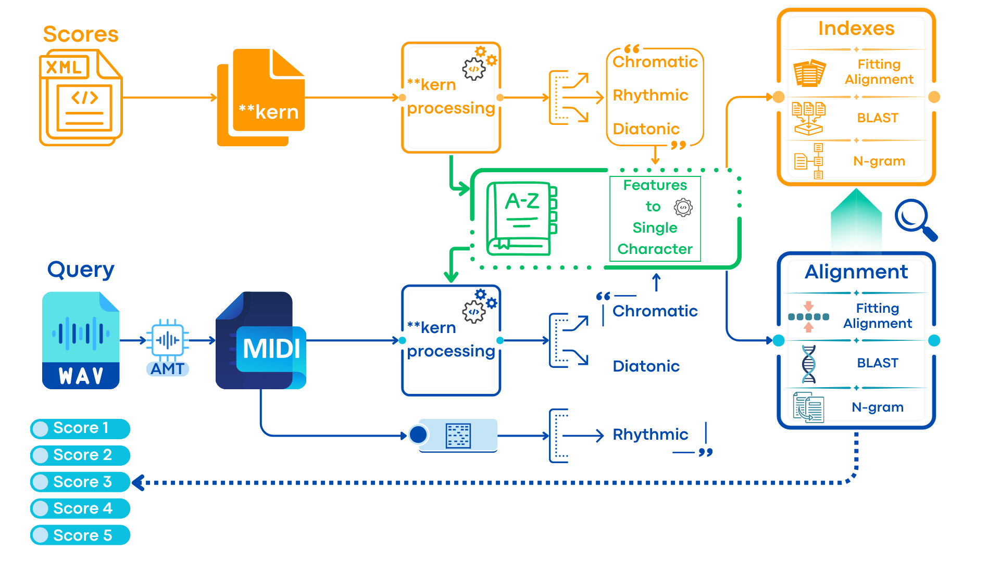
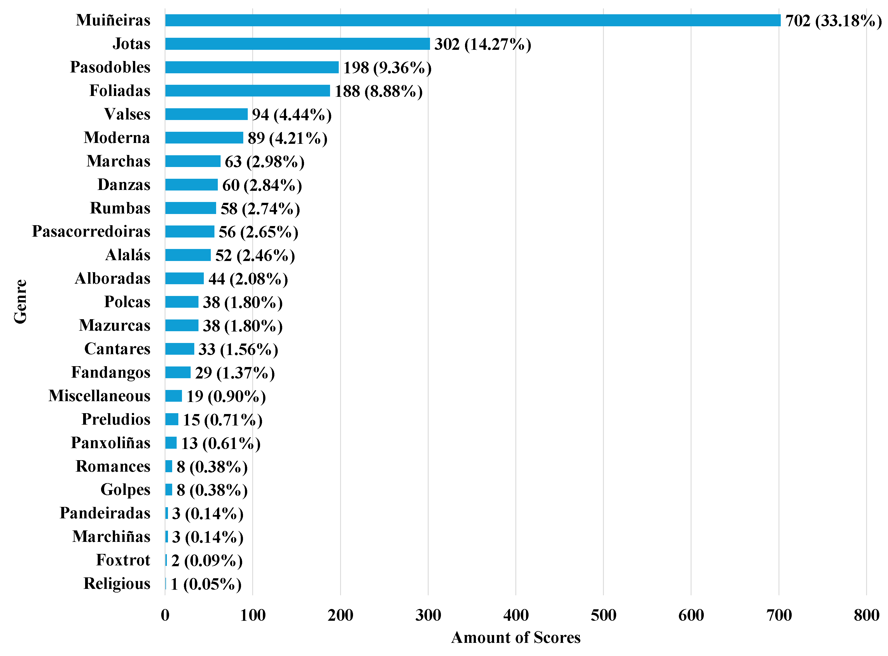
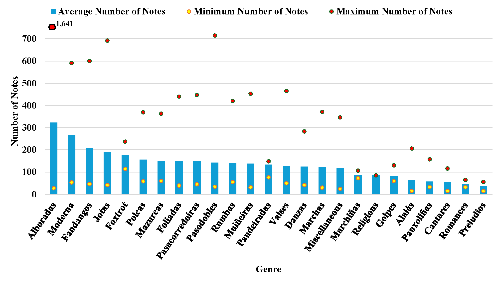
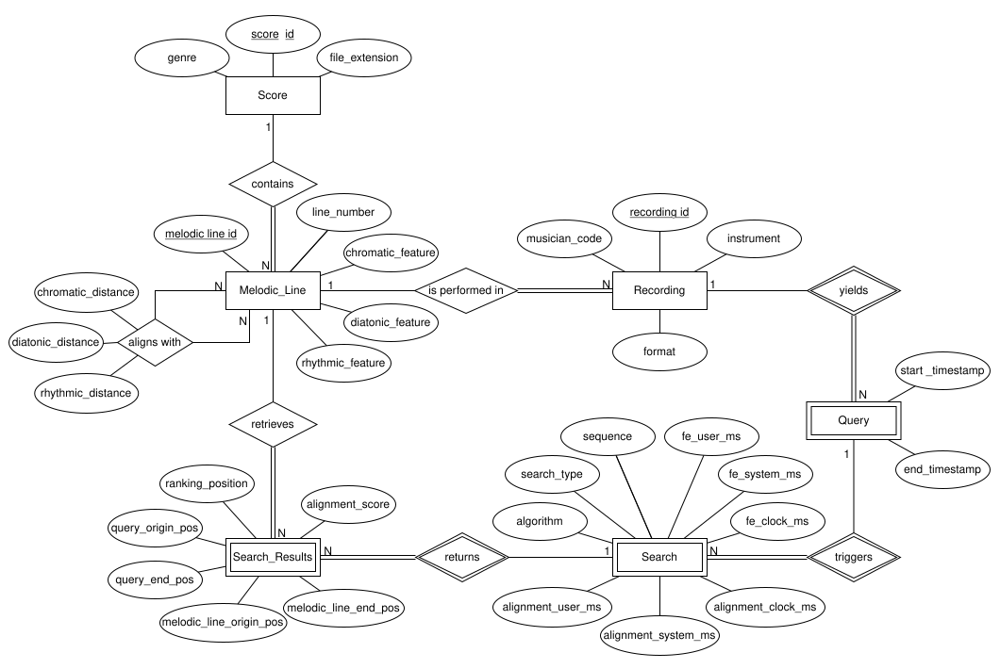
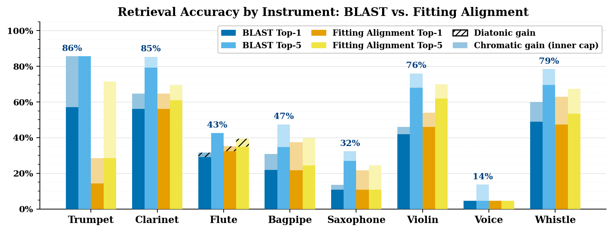
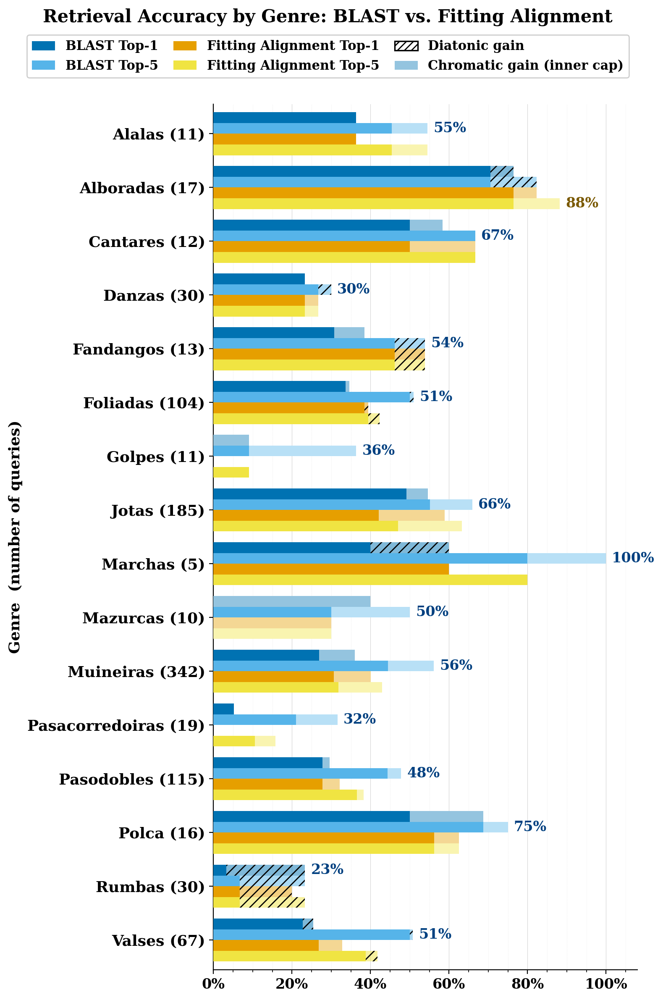
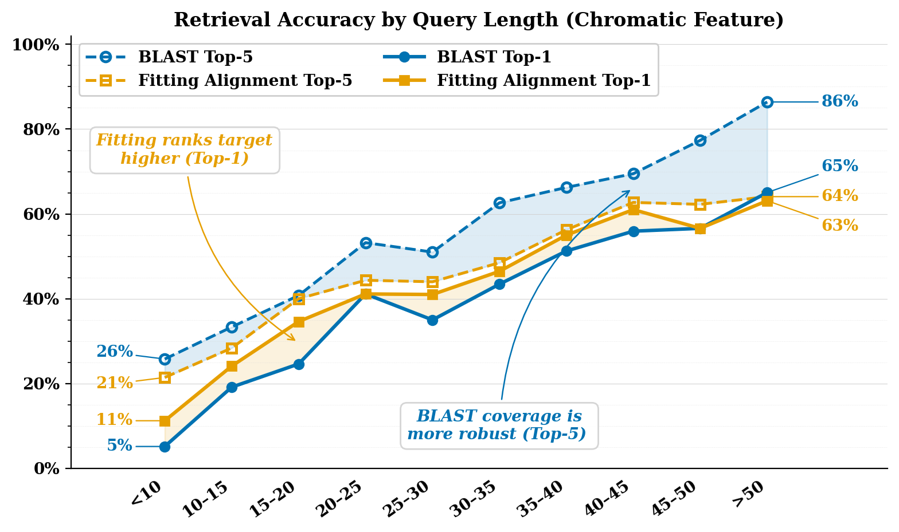
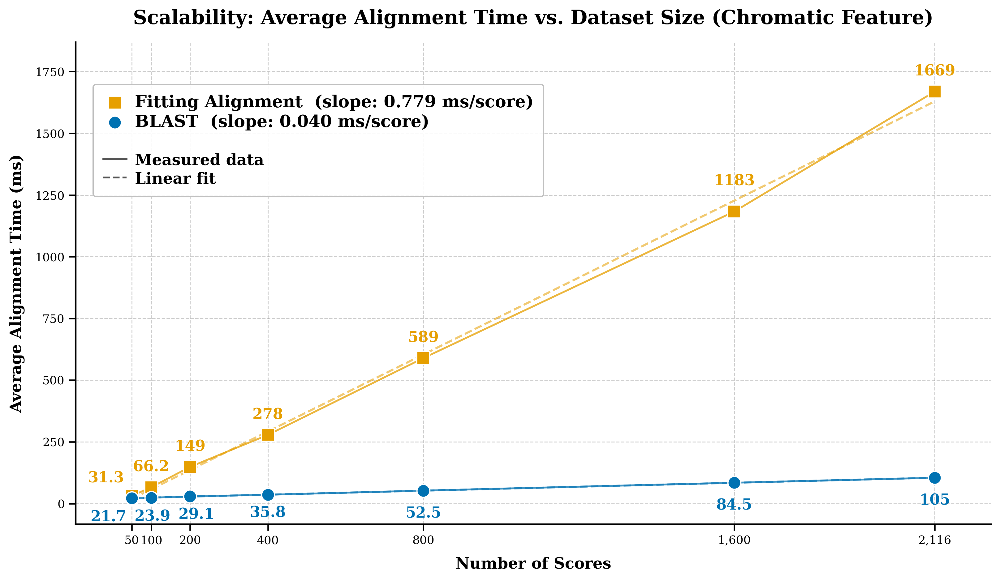

# **FUGA-ID** & **Folkoteca Galega Research Corpus**

[](https://doi.org/10.5281/zenodo.19151894)

**FUGA-ID** (Folk mUsic Genome Alignment for IDentification) is a cross-modal system designed to retrieve symbolic representations of folk melodies by playing an instrument or humming. The system uses sequence alignment techniques inspired by genomics to identify musical pieces from partial or varied interpretations.

This repository contains both the FUGA-ID system and the Folkoteca Galega Research Corpus (FGRC), a collection of traditional Galician folk music in symbolic format, along with multiple recordings of the same melodies performed by different musicians and instruments.

## Table of Contents

- [**FUGA-ID** \& **Folkoteca Galega Research Corpus**](#fuga-id--folkoteca-galega-research-corpus)
  - [Table of Contents](#table-of-contents)
  - [System Overview](#system-overview)
    - [Key Features](#key-features)
      - [Scores Processing](#scores-processing)
      - [Query Processing](#query-processing)
    - [Code Distribution](#code-distribution)
  - [Folkoteca Galega Research Corpus](#folkoteca-galega-research-corpus)
    - [Dataset Statistics](#dataset-statistics)
    - [Recordings](#recordings)
  - [Download and Setup](#download-and-setup)
    - [Requirements](#requirements)
    - [Setup](#setup)
  - [Running Tests](#running-tests)
    - [Results Database](#results-database)
  - [System Evaluation](#system-evaluation)
    - [Dataset Similarity Analysis](#dataset-similarity-analysis)
    - [AMT Systems Comparison](#amt-systems-comparison)
    - [Performance Metrics](#performance-metrics)
      - [Multi-Instrument Test Set](#multi-instrument-test-set)
      - [Piano Dual-Capture Test Set](#piano-dual-capture-test-set)
      - [Scalability Analysis](#scalability-analysis)
  - [Glossary](#glossary)
  - [Licence](#licence)
  - [How to Cite This Work](#how-to-cite-this-work)

## System Overview

The diagram below shows the system architecture. The upper block (yellow) covers score processing at [*scores*](fuga-id/scores/); the middle block (green) holds shared utilities at [*common*](fuga-id/common/); the lower block (blue) covers query processing and alignment at [*queries*](fuga-id/queries/).



### Key Features

#### Scores Processing

- Converts MusicXML scores to \*\*kern format and extracts their melodic lines.
- Computes the chromatic intervals, diatonic intervals and rhythm ratios from each melodic line.
- Prepares the extracted features for both alignment algorithms:
  - Creates feature text files and cost maps for the Fitting Alignment algorithm
  - Builds searchable indexes for the BLAST algorithm

#### Query Processing

- Accepts WAV or MIDI files as input for searching.
- Extracts the features from the query file.
- Performs approximate alignment using either the Fitting Alignment algorithm or the [BLAST](https://blast.ncbi.nlm.nih.gov/Blast.cgi) algorithm. You can also configure it to use $n$-gram indexing.
- Returns the Top 5 best-matching music scores.

### Code Distribution

The code is organised into the following directories:

- *amt_evaluation* : Contains a unified pipeline to evaluate Automatic Music Transcription (AMT) systems using metrics relevant to folk melody retrieval (note-level F1, melodic interval accuracy, and rhythm accuracy).
- *analysis* : Contains implementations of the global alignment algorithm to evaluate similarity between pieces in the dataset.
- *common* : Stores code shared between different system modules.
- *database* : Includes everything related to building and analysing the database generated during tests.
- *queries* : Contains scripts and data to process queries and perform alignments against the features extracted from the scores.
- *scores* : Groups code and data needed to extract features from scores and prepare them for the alignment algorithms.

## Folkoteca Galega Research Corpus

The Folkoteca Galega Research Corpus (FGRC) consists of 2,116 traditional folk music pieces from Galicia (northwest Spain), provided in MusicXML format (2,083 are also available in MIDI). These pieces are categorised into 25 distinct genres. You can find them at [*Scores MusicXML*](fuga-id/scores/data/origin/scores_musicxml/) and [*Scores MIDI*](fuga-id/scores/data/origin/scores_midi/) folders.

The FGRC should not be confused with the [Folkoteca Galega](https://folkotecagalega.gal/pezas) itself, the collaborative archive that collects and curates the notated material. The FGRC is the curated, versioned snapshot assembled for research use: it fixes a specific state of the notated material and extends it with the performer recordings described below.

### Dataset Statistics


*Figure 1. Distribution of scores across the 25 musical genres in the dataset.*


*Figure 2. Average note count per score by genre.*

### Recordings

Two sets of audio recordings are available for testing:

- **Multi-Instrument Set** — [General Recordings](fuga-id/queries/data/folkoteca_audios/):
  Contains 156 WAV files recorded by 10 different musicians using 8 instruments (bagpipe, clarinet, recorder, saxophone, trumpet, violin, voice, and tin whistle). Piano recordings are not included in this set.
- **Piano Dual-Capture Set** — [Piano Recordings](fuga-id/queries/data/folkoteca_piano_recordings/):
  A collection of 50 piano performances, available in both WAV and MIDI formats (totalling 100 files).

| Instrument               | Recordings | Total duration | Mean duration |
| ------------------------ | :--------: | -------------: | ------------: |
| Recorder                 |     50     |          38:41 |          0:46 |
| Bagpipe                  |     47     |          33:09 |          0:42 |
| Tin whistle              |     21     |          15:38 |          0:45 |
| Clarinet                 |     13     |           8:52 |          0:41 |
| Violin                   |     11     |           5:33 |          0:30 |
| Saxophone                |     6      |           3:56 |          0:39 |
| Voice                    |     5      |           2:31 |          0:30 |
| Trumpet                  |     3      |           0:43 |          0:14 |
| **Multi-Instrument Set** |  **156**   |     **109:04** |      **0:42** |
| Piano (dual capture)     |     50     |         ~56:00 |          1:07 |
| **Total**                |  **206**   |    **~165:04** |      **0:48** |
 
*Durations are given as mm:ss. The Piano row counts 50 performances; each was
captured simultaneously as WAV and MIDI, yielding 100 files.*

## Download and Setup

### Requirements

- [Git](https://git-scm.com/)
- [Docker](https://www.docker.com/)

### Setup

1. Clone the source repository:

   ```bash
   git clone https://github.com/hromerovelo/fuga-id.git
   ```
2. Get the Docker image — either build it locally:

   ```bash
   cd fuga-id
   docker build -t fuga-id:1.0 .
   ```

   or pull the pre-built image from Docker Hub:
   ```bash
   docker pull hrvelo/fuga-id:1.0
   ```
3. Create and run the docker container:

   ```bash
   docker run -d -p 2222:22 --name fuga-id_container fuga-id:1.0
   ```
4. Connect via SSH to the running container using the default credentials (*user*/*user*):

   ```bash
   ssh user@localhost -p 2222
   ```
5. Navigate to the *fuga-id* folder:

   ```bash
   cd fuga-id
   ```

## Running Tests

Before running a new general test, it is necessary to run the following command to delete all previously computed data:

```bash
bash clean_run.sh
```

To perform a general test with queries extracted from the multi-instrument set of 156 recordings, please execute:

```bash
bash run_fuga-id.sh
```

You can also select the piano set of recordings by adding a flag *-p*:

```bash
bash run_fuga-id.sh -p
```

Results will be available at *folkoteca.db* in the [database](fuga-id/database/) folder, along with an XLSX file with the performance and ranking metrics obtained. You can access the *folkoteca.db* and run any SQL query executing:

```bash
cd database
sqlite3 folkoteca.db
```

### Results Database

When a general test is conducted, the system generates a database with the obtained results. This database stores detailed information about processed queries, retrieved scores, and system performance metrics.

The following entity-relationship (ER) diagram shows the database structure:


*Figure 3. Entity-Relationship (ER) diagram of the results database.*

The database allows subsequent analysis of system performance, such as:

- Success rates by musical genre
- Effectiveness according to the instrument used in the query
- Impact of query length on result accuracy

The analysis script generates an XLSX report from the database:

```bash
cd database
python3 analyze_results.py
```

By default, a result is counted as a hit only when the retrieved melodic line belongs to the same score as the query. Optionally, you can use **global alignment** as a relaxed hit criterion: a result is also counted as a hit when it is melodically similar to the query melody according to pre-computed global alignment distances. This is useful when musically equivalent variants of the same tune appear under different scores. To enable it:

```bash
python3 analyze_results.py --use-global-alignment
```

This requires a pre-computed `global_folkoteca.db` (generated by the *analysis* module). The `--use-global-alignment` flag merges both databases and applies the flexible hit definition from [report_queries_global_hits.py](fuga-id/database/report_queries_global_hits.py).

## System Evaluation

### Dataset Similarity Analysis

To assess the internal similarity of the FGRC, we computed pairwise global alignment distances between all melodic lines for each feature type. This analysis helps to understand the distinctiveness of pieces within the corpus.

**Pairwise Feature Distance Distribution (2,915 melodic lines)**

| **Distance**    | **Chromatic** | **Diatonic** | **Rhythm** |
| --------------- | ------------- | ------------ | ---------- |
| Exact (0)       | 41            | 46           | 45         |
| Near (1–10)     | 115           | 202          | 1,374      |
| Similar (11–20) | 588           | 1,583        | 42,650     |
| Distinct (>20)  | 99.98%        | 99.96%       | 99.00%     |

*Notes:*

- All three features <10: 81 pairs (0.002%)
- Chromatic and Diatonic = 0: 41 pairs
- All three features = 0: 20 pairs

To run this analysis yourself, execute the following within the *analysis* folder:

```bash
python3 compute_corpus_global_alignment.py
```

The full numerical results of the similarity analysis are available at [benchmark/dataset_similarity_analysis.xlsx](benchmark/dataset_similarity_analysis.xlsx).

### AMT Systems Comparison

Four AMT systems were evaluated on several audio files across multiple instruments and scenarios. The full comparison is available at [benchmark/amt_systems_comparison.xlsx](benchmark/amt_systems_comparison.xlsx).

One scenario evaluates on the 156 multi-instrument recordings, transcribed from the original WAV audio and compared against the MIDI of the original score. This is a realistic retrieval event: the query is an acoustic recording and the database holds notated scores.

| System      | Note F1 | Interval Accuracy | Rhythm Accuracy | Avg. Time/file |
| ----------- | ------- | ----------------- | --------------- | -------------- |
| Basic Pitch | 0.090   | 0.380             | 0.476           | 1.4 s          |
| CREPE Notes | 0.110   | 0.442             | 0.468           | 32.7 s         |
| pYIN        | 0.079   | 0.350             | 0.382           | 8.6 s          |
| Swift-F0    | 0.039   | 0.092             | 0.271           | 0.7 s          |

*Notes:*

- **CREPE Notes** achieves the best interval and rhythm accuracy but is ~23× slower than Basic Pitch.
- **Basic Pitch** offers the best speed–accuracy trade-off and is used as the primary transcription engine.
- All systems score significantly higher on synthesized piano audio than on real instrument recordings.
- For retrieval purposes, interval and rhythm metrics are more informative than strict note-level F1.

To run the AMT evaluation yourself, execute within the *amt_evaluation* folder:

```bash
python run_full_evaluation.py
```

### Performance Metrics

The FUGA-ID system has been extensively evaluated using multiple test sets. The complete performance metrics for both test sets are available at [benchmark/folkoteca_report.xlsx](benchmark/folkoteca_report.xlsx).

#### Multi-Instrument Test Set

Using 156 recordings (987 queries) from 10 musicians and 8 instruments (excluding piano):

- **Top-5 accuracy: 54%** for chromatic feature with BLAST algorithm
- **65% Top-1 accuracy** for longer queries (>50 seconds)
- **86% Top-5 accuracy** for longer queries (>50 seconds)
- BLAST algorithm is approximately 16 times faster than Fitting Alignment (average 105ms vs 1,669ms per query)
- Pitch features (chromatic and diatonic) significantly outperform rhythmic features

Performance varies by several factors:


*Figure 4. Retrieval accuracy by instrument type, showing their impact on hit rates.*


*Figure 5. Top-1 and Top-5 retrieval accuracy per genre for BLAST and Fitting Alignment.*


*Figure 6. Effect of query length on retrieval accuracy.*

The queries used in this test set are available at [benchmark/queries_multi_instrument.json](benchmark/queries_multi_instrument.json). This file lists all queries from the Multi-Instrument Set, with each entry specifying the recording, instrument, reference score, and time segment used as query.

#### Piano Dual-Capture Test Set

Using 50 piano performances (over 300 queries) captured in both WAV and MIDI formats:

- Direct MIDI input significantly outperforms WAV audio conversion
- For chromatic feature with Fitting Alignment:
  - MIDI: Top-5 accuracy of 77.4%, MRR of 0.720
  - WAV: Top-5 accuracy of 46.9%, MRR of 0.442
- For chromatic feature with BLAST:
  - MIDI: Top-5 accuracy of 85.2%, MRR of 0.716
  - WAV: Top-5 accuracy of 58.1%, MRR of 0.468

The queries used in this test set are available at [benchmark/queries_piano.json](benchmark/queries_piano.json). Each entry specifies the recording, format (WAV or MIDI), instrument, reference score, and time segment used as query.

#### Scalability Analysis

The system's scalability was evaluated using progressively larger subsets of the dataset:

- BLAST maintains efficient performance as database size increases
- Fitting Alignment grows markedly faster than BLAST as the database expands


*Figure 7. Scalability of Fitting Alignment and BLAST as the database grows.*

## Glossary

The table below provides a list of terms used in this repository to facilitate understanding.

| Term          | Definition                                                                                                                                           |
| ------------- | ---------------------------------------------------------------------------------------------------------------------------------------------------- |
| *chromatic*   | Refers to the distance in semitones between one note and the following.                                                                              |
| *diatonic*    | Refers to the interval number between one note and the following.                                                                                    |
| *feature*     | Characteristic retrieved from a musical piece. We consider two pitch features (chromatic and diatonic) and a rhythmic one.                           |
| *genre*       | Category describing the traditional musical form, style, or functional type of a piece within its cultural context (e.g., Alborada, Muiñeira, Jota). |
| *rhythm*      | The rhythm feature is computed as the ratio of duration between one note and the preceding.                                                          |
| *search type* | Feature selected to undertake the alignment.                                                                                                         |

## Licence
 
The source code is released under the BSD 2-Clause licence. All contents of the Folkoteca Galega Research Corpus (FGRC)—including the scores, the musical recordings in both audio and MIDI form, and any data derived from them—are released under CC BY-NC 4.0. For the avoidance of doubt,
research use is considered non-commercial irrespective of the researcher's
institutional affiliation and funding source, including research carried out
within commercial organisations. Commercial use refers to selling the corpus,
or incorporating it into a product or service offered for sale; for such uses,
please contact the authors. Attribution must be given by citing the associated
article. See [LICENSE](LICENSE) for the full terms.
 
## How to Cite This Work

If you use the Folkoteca Galega Research Corpus or the FUGA-ID software, please cite the following article:

> Romero-Velo, H., Bernardes, G., Ladra, S., Paramá, J. R., & Silva-Coira, F. (2026).
> FUGA-ID: A Cross-Modal Approach to Symbolic Folk Melody Identification.
> (Under review)

BibTeX

```bibtex
@article{romero2026fugaid,
  title={FUGA-ID: A Cross-Modal Approach to Symbolic Folk Melody Identification},
  author={Romero-Velo, Hilda and Bernardes, Gilberto and Ladra, Susana and Param{\'a}, Jos{\'e} R. and Silva-Coira, Fernando},
  year={2026},
  note={Under review}
}
```

You may also cite the Zenodo archive containing the dataset, metadata, and source code:

> Romero-Velo, H. (2026). Folkoteca Galega Research Corpus (FGRC): a dual ground-truth dataset for cross-modal folk melody retrieval.
> Zenodo.
> https://doi.org/10.5281/zenodo.19151894

BibTeX

```bibtex
@misc{romero2026zenodo,
  author       = {Romero-Velo, Hilda},
  title        = {Folkoteca Galega Research Corpus (FGRC): a dual ground-truth dataset for cross-modal folk melody retrieval},
  year         = {2026},
  publisher    = {Zenodo},
  doi          = {10.5281/zenodo.19151894},
  url          = {https://doi.org/10.5281/zenodo.19151894},
  note         = {Dataset, metadata, and source code archive}
}
```
